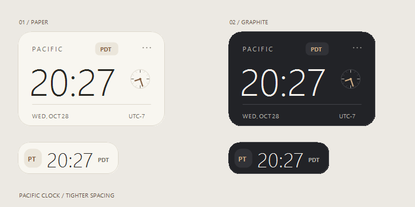

# Pacific Clock · 太平洋桌面时钟 Skill

A quiet, native Windows desktop clock for US Pacific time — install the skill once, then ask your agent to open it.

在桌面随时查看美国西海岸时间。自动切换 **PST / PDT**，提供暖白 / 石墨主题、精简模式、置顶、透明度和鼠标穿透。首次启动默认精简悬浮显示，**不显示主任务栏按钮，只保留托盘图标**。



## 直接发给 Agent 的安装提示词

复制下面整段，交给在你的 Windows 电脑上运行的 Codex 或其他支持 Agent Skills 的助手：

```text
请帮我安装并启动太平洋桌面时钟 Skill，仓库：
https://github.com/zycc853/pacific-clock-skill

安装命令：
npx skills add zycc853/pacific-clock-skill --skill pacific-clock -g -y

安装后立即调用 pacific-clock，按技能说明在我实际使用的 Windows 桌面启动时钟。
使用精简悬浮模式，不在主任务栏显示按钮，只保留右下角托盘图标。
保留拖动位置、等比缩放和 PST/PDT 自动切换功能，不要自动开启开机启动。
如果已安装则更新，保留现有主题、位置、缩放等偏好；本次明确将显示模式设为悬浮。
遇到缺少安装工具时，先按仓库 README 选择可用的安装方式；完成后告诉我如何打开设置和退出。
```

Codex 用户也可在安装命令末尾加 `-a codex`，仅安装到 Codex。

## 一条命令安装 Skill

需要 Node.js 和支持 Agent Skills 的 AI 编程助手。运行：

```sh
npx skills add zycc853/pacific-clock-skill --skill pacific-clock -g -y
```

随后在 Codex 中说：

```text
使用 $pacific-clock，在我的 Windows 桌面打开太平洋时钟。
```

也可直接说“打开太平洋桌面时钟”。Skill 会准备程序并选择正确的桌面启动方式。其他支持 Agent Skills 的助手可使用各自的技能调用方式。

只安装到 Codex：

```sh
npx skills add zycc853/pacific-clock-skill --skill pacific-clock -g -y -a codex
```

安装与调用是两个动作；Skill 本身不会在安装时自动启动程序。时钟运行不依赖 Node.js、Python 或浏览器。

## 不用 AI 助手，也能直接运行

从 [最新 Release](https://github.com/zycc853/pacific-clock-skill/releases/latest) 下载 `PacificClock-Windows.zip`，解压后双击 `PacificClock.exe`。找不到窗口时，双击 `FindPacificClock.exe`。

**支持 Windows 10/11 + 系统自带 .NET Framework 4.x。** macOS / Linux 暂无原生版本。

## 使用

- 左键拖动中间区域移动窗口，右键或点击 `···` 打开设置。
- **缩放比例**：50%～200%，提供 50 / 65 / 75 / 85 / 100 / 125 / 150 / 200% 档位；拖动边缘或角落可连续等比缩放，自动保存大小和位置。
- **外观主题**：暖白 `Paper` / 石墨 `Graphite`。
- **精简模式**：170 × 54 的横向胶囊（显示秒为 202 × 54），时间与时区紧凑排列；完整卡片为 248 × 160。以上为 100% 缩放下的逻辑尺寸。
- **默认悬浮模式**：隐藏主任务栏按钮，不抢键盘焦点，保留右下角托盘图标；托盘图标可能在 Windows 的隐藏图标小框中。
- **普通窗口模式**：在任务栏中显示，方便找回。
- **鼠标穿透**：可通过托盘菜单或 `FindPacificClock.exe` 解除。
- **开机启动**：菜单中自行开启，默认关闭。

时间采用 Windows 的 `Pacific Standard Time` 时区规则，对应洛杉矶。程序只读取系统时钟，不修改系统时区。设置保存在程序目录的 `PacificClock.settings.xml`，更新时保留它。

## 手动准备 / 启动

在仓库目录的 PowerShell 中：

```powershell
# 默认准备到 %LOCALAPPDATA%\PacificClock，不启动窗口
./skills/pacific-clock/scripts/prepare.ps1

# 普通交互式 PowerShell 可直接准备并启动
./skills/pacific-clock/scripts/start.ps1

# 找回窗口
./skills/pacific-clock/scripts/start.ps1 -Find
```

如果 Agent 的命令行运行在隔离桌面，`start.ps1` 返回 `requires-interactive-launch`，Agent 应从原生桌面控制工具打开返回的 `appPath`。只有用户需要找回不可见的窗口时，才使用 `finderPath`；找回功能会切换到带任务栏按钮的普通模式。仅检查“进程存在”不能证明用户看到了窗口。

## 源码与验证

```powershell
./skills/pacific-clock/scripts/build.ps1 -OutputDirectory ./_build
./skills/pacific-clock/scripts/verify.ps1 -ExecutablePath ./_build/PacificClock.exe
```

源码、预编译 EXE、Skill 和启动脚本都在 `skills/pacific-clock/` 内，安装 Skill 后可独立使用。构建使用 Windows 自带 C# 编译器，无需 .NET SDK。27 项验证覆盖夏令时切换、跨天、设置保存、窗口行为、缩放与拖拽边界，以及首次启动的悬浮模式；GitHub Actions 会重新编译并验证。

界面预览来自实际绘制代码。程序运行无需联网；时间准确性取决于电脑系统时钟与 Windows 时区规则。

## License

[MIT](LICENSE)
